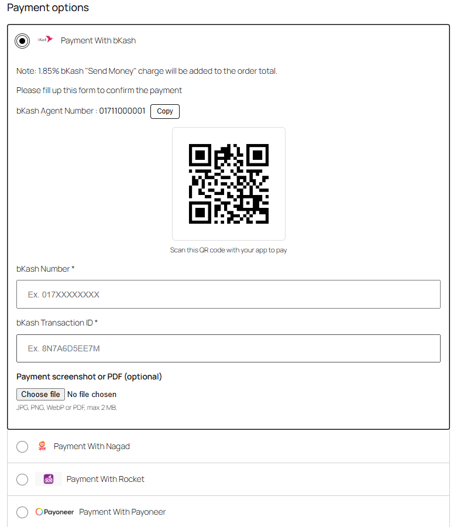
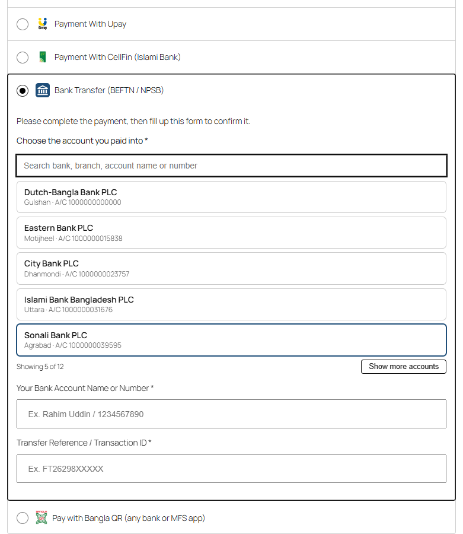
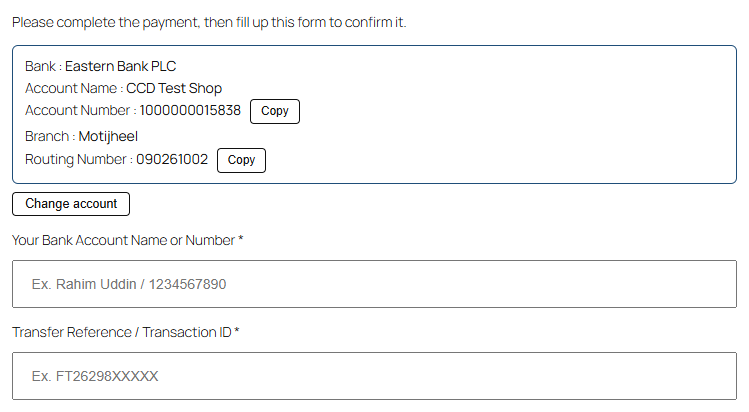
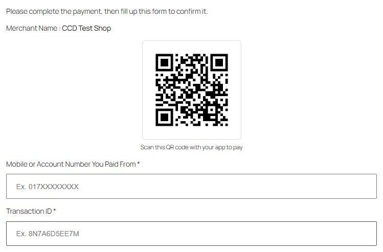
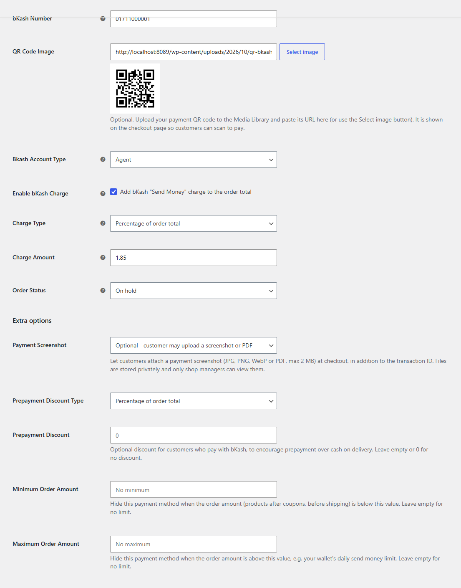
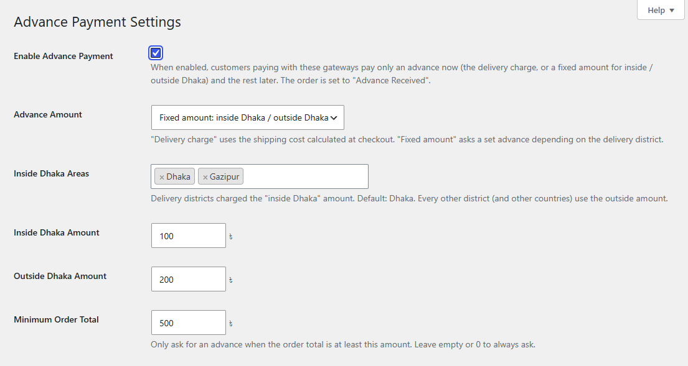

# CodeCareBD - Payment Gateway for WooCommerce

Free manual payment gateways for Bangladeshi WooCommerce stores: **bKash, Nagad, Rocket, Upay, CellFin (Islami Bank), Bangla QR, bank transfer (BEFTN / NPSB) and Payoneer**. Works with the WooCommerce **block checkout** and the classic checkout, and is **HPOS** compatible.

The customer pays you from their own app or bank, then confirms the payment at checkout with their number and Transaction ID (and optionally a screenshot). You verify it and process the order. No merchant API, no monthly fee.

**Install:** [wordpress.org/plugins/codecarebd-bkash-nagad-rocket-payoneer-gateway](https://wordpress.org/plugins/codecarebd-bkash-nagad-rocket-payoneer-gateway/)

## Screenshots

| Checkout (bKash) | Bank Transfer: many accounts |
|---|---|
|  |  |
| **Chosen bank account** | **Bangla QR** |
|  |  |
| **Gateway settings** | **Advance payment (inside / outside Dhaka)** |
|  |  |

## Features

- **8 payment methods:** bKash, Nagad, Rocket, Upay, CellFin, Bangla QR, bank transfer and Payoneer.
- **Multiple bank accounts:** customers search and pick the account they paid into (5 at a time, "Show more").
- **Duplicate Transaction ID protection** on every method.
- **Payment screenshot / PDF upload** per method (off / optional / required), stored privately; only shop managers can view.
- **Send money charge** (percentage or fixed) and **prepayment discount** per method, updated live at checkout.
- **Minimum / maximum order amount** per method.
- **Advance payment:** delivery charge or fixed inside / outside Dhaka amount, optional minimum order total, "Advance Received" order status.
- **Smart number input:** Bangla digits, +880, spaces/dashes, 12-digit Rocket account numbers.
- **Settings checks** on save, so a misconfigured method never reaches customers.
- Copy buttons, QR codes, order list columns, My Account columns, thank-you and email instructions per method.

## Requirements

| | Minimum | Tested up to |
|---|---|---|
| WordPress | 6.3 | 7.1 |
| WooCommerce | 6.3 | 11.2 |
| PHP | 7.3 | 8.4 |

## Setup

1. Install and activate WooCommerce and this plugin.
2. **WooCommerce > Settings > Payments**: enable the methods you want and enter your number, bank accounts or Payoneer email. Add QR codes with "Select image".
3. Optional per method: charge, discount, payment screenshot, min/max amount, order status.
4. Optional: **WooCommerce > Advance Payment**.

Full user documentation, FAQ and changelog: [`readme.txt`](readme.txt).

## Development

| Path | Purpose |
|---|---|
| `ccd-payment-gateway.php` | Bootstrap, checkout field save/validation, admin order display, advance payment |
| `includes/ccd-features.php` | Gateway config (single source of truth), validation, charges/discounts, min/max, settings checks, account display, review notice |
| `includes/ccd-payment-proof.php` | Private payment screenshot upload, attach, admin viewer, cleanup |
| `includes/classes/CCD_Payment_*.php` | bKash, Nagad, Rocket, Payoneer gateways (settings keys kept from earlier versions) |
| `includes/classes/class-ccd-gateway-base.php` | Base class + Upay, CellFin, Bank Transfer, Bangla QR |
| `includes/blocks/`, `assets/js/blocks/` | Cart & Checkout Blocks integration (no build step) |
| `assets/js/ccd_scripts.js` | Classic checkout: copy button, uploads, bank account picker |
| `.wordpress-org/` | WordPress.org banners, icons and screenshots (synced to SVN `assets/`) |

Hooks for developers:

- `ccd_block_duplicate_transaction_id` (bool, `$gateway_id`) - return `false` to allow reused Transaction IDs.
- `ccd_advance_payment_amount` (float, `$country`, `$state`, `$order_total`) - adjust the advance amount.
- `ccd_advance_payment_title`, `ccd_advance_payment_text`, `ccd_remaining_payment_text` - advance notice wording.

## Releasing

WordPress.org SVN is the distribution channel; this repository is the source. Releases are published by a GitHub Actions workflow. See [`RELEASING.md`](RELEASING.md).

## Support

Questions and suggestions: [codecarebd.com/contact](https://codecarebd.com/contact) or the [WordPress.org support forum](https://wordpress.org/support/plugin/codecarebd-bkash-nagad-rocket-payoneer-gateway/).

## License

GPLv2 or later. See [`license.txt`](license.txt).
